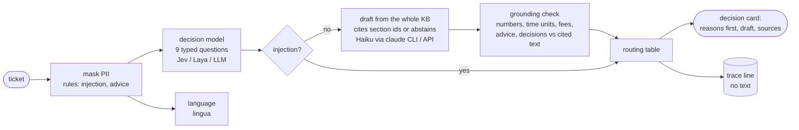

# Support co-pilot for a forex/CFD broker

Processes an incoming support ticket for an agent: classifies it, drafts a reply grounded in the
Valetax help pages with citations (or abstains), and routes it to a person whenever a hard rule
or the evidence requires it. Python 3.12, uv; a CLI and a static HTML page for agents.



**Results** on 80 hand-labelled tickets (details and intervals in [docs/evals.md](docs/evals.md)):
0 hard-rule violations; every one of the 48 tickets that needs a person reached one; 30 of 32
answerable tickets got a ready draft (the two misses are thank-you notes); route accuracy 98%
(95% CI 91–99%); about $0.0005 per ticket at API prices with Jev classification and Haiku
drafting. Sonnet adds nothing measurable; zero-shot Laya is safe but sends nearly everything
to a person. The business case: [docs/business-case.md](docs/business-case.md).

## Run it

```bash
uv sync --all-extras                     # the laya extra pulls torch; skip it with plain `uv sync`
export TYPESAFE_API_KEY=...              # Jev classifier (default)
uv run copilot run "My withdrawal is pending for 3 days. Also, should I buy gold now?"
uv run copilot run --classifier laya "Какие документы нужны для верификации?"   # fully local classifier
uv run copilot run --json --file ticket.txt
```

The drafter defaults to `--llm claude-cli --model haiku`, which shells out to an authenticated
`claude` CLI (Claude Code). With an API key use `--llm anthropic` (written, not run: see
[decisions §11](docs/decisions.md#11-claude-subscription-cli-for-development-the-api-for-production)).
Each run appends one line to `traces/traces.jsonl`.

Agent view: `uv run copilot view evals/results/2026-10-22-v3/jev+haiku/cards.jsonl -o agent-view.html`
and open the file; the cards are embedded, no server needed.

Evals and tests:

```bash
uv run pytest                                              # no network, fake models
uv run python -m evals.run run --classifier jev --model haiku   # golden set, one configuration
uv run python -m evals.run report --date 2026-10-22            # re-score saved cards, no model calls
```

## Requirement → where

| Requirement | Where |
|---|---|
| Classify: category, urgency, language, sentiment | `src/copilot/classify/` (questions in `questions.py`), `src/copilot/language.py` |
| Draft grounded in the KB with citations, or abstain | `kb/valetax.toml`, `src/copilot/draft.py`, `src/copilot/grounding.py` |
| Route to a human reviewer whenever required | `src/copilot/routing.py`, `src/copilot/pipeline.py` |
| Fail safely: any failure is a card for a person, transient errors retried | `src/copilot/errors.py`, the boundary in `Copilot.process` ([decisions §15](docs/decisions.md)); the Anthropic API backend is written against the SDK docs, not run live |
| No trading advice; detect and decline politely | `rules.asks_trading_advice`, the `trading_advice` question, `draft.TRADING_DECLINE`, `rules.gives_trading_advice` |
| Never decide complaint, KYC or AML outcomes | fixed acknowledgements in `draft.ACKNOWLEDGEMENT`, `rules.py` patterns and the `REPLY` questions on every draft ([decisions §8](docs/decisions.md)), routing reasons |
| Never invent policy, fees or timelines | `grounding.check_draft` with `quantities.py`, abstention in the draft schema |
| KB used as is, gaps and inconsistencies included | `kb/valetax.toml`, [docs/kb-issues.md](docs/kb-issues.md) |
| Measure it | `evals/`, [docs/evals.md](docs/evals.md) |
| Business case on one page | [docs/business-case.md](docs/business-case.md) |
| Phase 2: scale up | [docs/phase2.md](docs/phase2.md) |
| Built with an agentic coding tool | Claude Code; [CLAUDE.md](CLAUDE.md) is the project guide it worked from |

## Further reading

[docs/decisions.md](docs/decisions.md) → [docs/evals.md](docs/evals.md) →
[docs/business-case.md](docs/business-case.md) → [docs/kb-issues.md](docs/kb-issues.md) →
[docs/phase2.md](docs/phase2.md).
