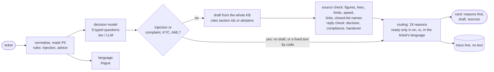

# Support co-pilot for a forex/CFD broker

For each incoming support ticket it classifies the ticket (category, urgency, language,
sentiment), drafts a reply from the Valetax help pages with citations or abstains, and routes the
ticket to a person whenever a hard rule or the evidence requires it. Nothing is sent to a client:
an agent reads every card. Python 3.12, uv; a CLI and a static HTML page for agents.

Built with Claude Code over ~2 days: I set the design, evals and gates; agents implemented and
reviewed ([docs/process.md](docs/process.md)).

**What the brief asked for, and what is done:** [docs/requirements.md](docs/requirements.md).

## Results

Jev classifier + Haiku drafter, run `2026-10-23`, its decisions replayed through the current code
(`evals.run replay --write`; every moved route is listed in [docs/evals.md](docs/evals.md#results)).
Full tables with intervals:
[`evals/results/2026-10-23.md`](evals/results/2026-10-23.md) (golden) and
[`evals/results/2026-10-23-challenge.md`](evals/results/2026-10-23-challenge.md) (blind).

| | golden set, 80 tickets | blind set, 60 tickets |
|---|---|---|
| hard-rule violations | 0 (95% upper bound 3.7%) | 0 (≤ 4.9%) |
| tickets that need a person and reached one (other languages always do) | 56 of 56 | 44 of 44 |
| route accuracy | 94% (86–97%); held-out 20: 90% | 97% (89–99%) |
| routed ready, and the label also says ready (route agreement, not a review of the text) | 19 of 19 | 14 of 14 |
| API cost per ticket, warm / cold cache | $0.00031 / $0.00049 | |

The reply check on the decision model has fired on 0 of the 157 drafts it read in the
2026-10-23 live runs, and caught 93 of 93 decisions, compliance checks and handovers on a
separate blind synthetic set of drafts
([`evals/results/drafts_challenge-patterns+jev.md`](evals/results/drafts_challenge-patterns+jev.md)):
insurance measured on synthetic positives, and the pilot decides whether it stays.

The checks on a draft read numbers with their units, time words, fee and guarantee phrases,
fee, limit and speed words, links, and names from closed lists (currencies, payment methods,
messengers, countries, instruments). A claim without any of these ("withdrawals go back to the
same account") is not checked by code: the drafter's rules and the agent who reads every card
cover it.

Sonnet adds nothing measurable at 8–13 times the model cost; the LLM classifier routes the same
within noise at 4.7 s against 0.33 s. Is it worth running: [docs/business-case.md](docs/business-case.md).

## Run it

```bash
uv sync --all-extras                     # the anthropic extra is the production LLM path
export TYPESAFE_API_KEY=...              # Jev classifier (default)
echo "My withdrawal is pending for 3 days. Also, should I buy gold now?" | uv run copilot run
uv run copilot run --json --file ticket.txt   # the ticket comes from stdin or a file, never argv
```

The drafter defaults to `--llm claude-cli --model haiku`, which shells out to an authenticated
`claude` CLI. With an API key use `--llm anthropic` (written, not run live:
[decisions §11](docs/decisions.md#11-claude-subscription-cli-for-development-the-api-for-production)).
Each run appends one line, without ticket text, to `traces/traces.jsonl`.

Agent view, the cards embedded in one HTML file, no server:

```bash
uv run copilot view evals/results/2026-10-23/jev+haiku+reply-jev/cards.jsonl -o agent-view.html
```

## How it works



| module | does |
|---|---|
| `src/copilot/pipeline.py` | the order of stages; any failure becomes a card for a person |
| `normalise.py`, `masking.py`, `rules.py` | one normalised text, PII masked, input patterns |
| `classify/` | the typed questions and the Jev and LLM backends |
| `draft.py`, `kb.py`, `kb/valetax.toml` | the drafter prompt and schema, the fixed texts, the KB |
| `grounding.py`, `quantities.py`, `terms.py`, `reply_guard.py` | checks on every draft |
| `routing.py` | the reasons, in order of severity, and the thresholds |
| `errors.py`, `llm.py` | three provider error kinds, one retry budget, the LLM backends |
| `cli.py`, `view.py`, `trace.py` | the CLI, the agent page, the trace writer |

## Evals and checks

```bash
uv run pytest                                                   # no network, fake models
uv run ruff check . && uv run ruff format --check . && uv run mypy
uv run python -m evals.gate 2026-10-23 2026-10-23-challenge     # the CI eval gate
uv run python -m evals.run run --classifier jev --model haiku   # a new golden run
uv run python -m evals.run replay --date 2026-10-23             # saved model outputs, current code
```

CI (`.github/workflows/ci.yml`) runs lint, types, the tests with any skip failing the build, and
the eval gate: the committed runs replayed through the current code must keep zero violations
and their route accuracy. `uvx pre-commit install` adds ruff and mypy as commit hooks.

## Documents

- [docs/requirements.md](docs/requirements.md): the brief, line by line, with proof and status
- [docs/decisions.md](docs/decisions.md): each decision, why, and what was rejected
- [docs/evals.md](docs/evals.md): the sets, the metrics, every result and its limits
- [docs/business-case.md](docs/business-case.md): worth running at 10,000 tickets a month, and how
- [docs/kb-issues.md](docs/kb-issues.md): the gaps and contradictions in the four help pages
- [docs/rollout.md](docs/rollout.md): launch stages, promotion and stop criteria, scaling triggers
- [docs/phase2.md](docs/phase2.md): what each scaling step builds, the weekly improvement loop
- [docs/process.md](docs/process.md): how it was built, by whom, and how it was reviewed
- [CLAUDE.md](CLAUDE.md): the guide Claude Code worked from (the brief asked for an agentic tool)
